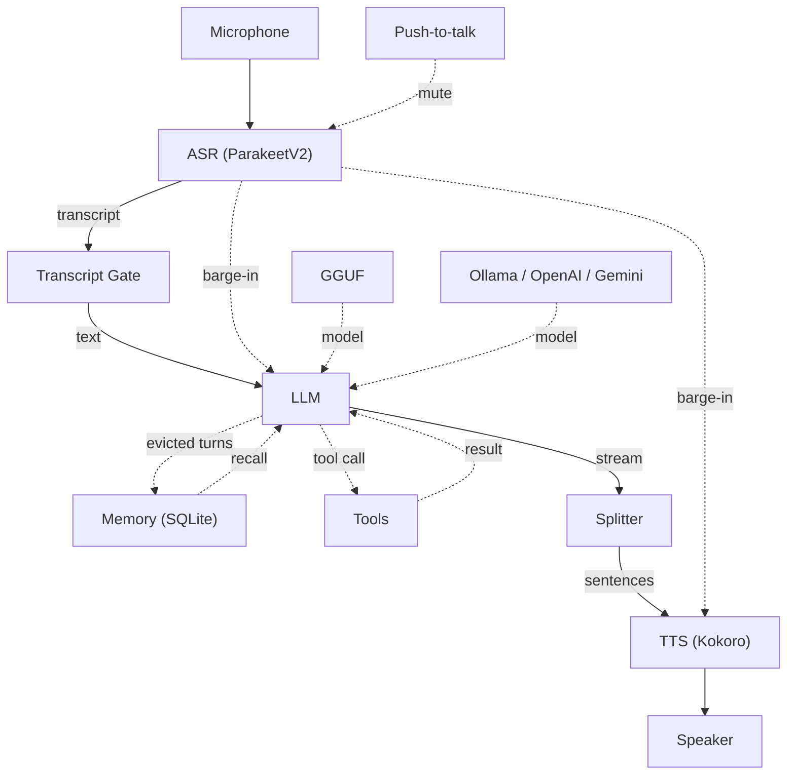

# voxpipe — Modular Voice Pipeline

[](LICENSE)
[]()
[](https://github.com/shervinemp/voxpipe/actions/workflows/ci.yml)

A modular voice-controlled pipeline. Speak, the LLM processes your intent
with tool calling, and the system responds aloud — streaming, interruptible,
and configurable.



## Quick Start

```bash
# 1. Install with the local-model stack
uv sync --extra asr --extra tts --extra gguf

# 2. Configure
cp config.example.yaml config.yaml

# 3. Run
uv run voxpipe
```

`voxpipe --help` lists the options (`--config`, `--push-to-talk`,
`--press-to-reset`, `--log-level`).

## Features

| Layer | What |
|---|---|
| **ASR** | Speech-to-text (ParakeetV2 or CrisperWhisper) with Silero VAD, push-to-talk, device auto-reconnect |
| **LLM** | Local GGUF models, or OpenAI / Gemini / Ollama through LiteLLM |
| **TTS** | Kokoro, spoken sentence by sentence as the reply is generated |
| **Barge-in** | Talking over a reply cancels generation and cuts playback |
| **Tools** | Tool calling with streaming decoders, chaining, async tools, and user-confirmed permissions |
| **Memory** | Conversation history in SQLite + FTS5; relevant past turns are recalled into context |
| **Topic tracking** | Keeps unrelated speech in bounded side buffers so it does not reach the LLM or speakers |
| **Busy mode** | Addressee-aware silence bias, deferred replies and personal corrections for shared spaces |
| **Hotkeys** | Push-to-talk and conversation reset |

## Configuration

Settings are layered: packaged defaults, then `config.yaml` (or `--config` /
`$VOXPIPE_CONFIG`), then environment variables named in `env:` blocks. Unknown
keys are rejected at startup with the offending key named.

```yaml
llm:
  backend: "local"       # "local" (GGUF) or "litellm" (remote APIs)
  model: "Gemma4_12B"
  max_tool_iterations: 1
  max_turns: 10          # turns (a question and its answer) kept in context
  local:
    Gemma4_12B:
      decoder: "legacy_xml"
  litellm:
    provider: "ollama"
    model: "qwen3:latest"
    api_base: "http://localhost:11434"

asr:
  sound_device: null     # index or name fragment; null = system default

hotkeys:
  push_to_talk: "<ctrl_r>+<shift_r>"
  press_to_reset: "<ctrl_l>+<ctrl_r>"

conversation_history:
  enabled: true
  db_path: "data/conversations.db"
  max_entries: 1000
  top_k: 2
  ttl_days: 30

topic_tracking:
  enabled: false          # always-on mode only; push-to-talk and typed input bypass it
  backend: "lexical"      # "lexical", "embedding", or "laya"
  threshold: null         # null = per-backend default
  ttl_sentences: 10       # drop an unused side topic after this many utterances
  max_unrelated: 4        # side topics kept at once
  promote_after: 0        # N consecutive side utterances promote it; 0 = never
```

## Architecture

```
src/
└── voxpipe/
    ├── core/            # Config (YAML + env vars), exceptions, model downloads
    ├── asr/             # Microphone capture, Silero VAD, ParakeetV2 / CrisperWhisper
    ├── tts/             # Kokoro ONNX, speech queue, interruptible audio player
    ├── llm/             # Session, conversation, tools, decoders, providers, context handling
    ├── pipeline/        # ASR → attention gate → LLM → TTS orchestration, hotkeys, events
    │   └── attention/   # Pluggable gates, buffers and relevance scorers
    ├── streaming/       # Sentence splitting
    ├── storage/         # Storage protocols, RAM and SQLite backends, MemoryStore
    └── data/            # Default config, model manifest
```

### Pipeline flow

1. **ASR** captures audio on its own thread; the VAD segments speech, and
   push-to-talk mutes the microphone between presses
2. **Transcript gate** drops noise before it reaches the LLM
3. **Attention gate** (when enabled) decides whether an utterance is for the
   assistant and routes it to the active conversation, a side topic, or an
   other/background buffer; non-addressed speech is not answered
4. **Memory** attaches relevant past turns to the new message as
   `(Earlier: ...)` context
5. **LLM** answers, calling tools when it needs to
6. **Sentence splitter** hands each sentence to TTS as soon as it is complete
7. **TTS** speaks it; if you start talking, generation is cancelled and
   playback stops (barge-in)

In always-on mode with loudspeakers the microphone can hear the reply and
interrupt it; use headphones or push-to-talk.

### Topic tracking

An always-on microphone hears conversations that are not meant for the
assistant. `topic_tracking` keeps the active conversation (`main`) and up to
`max_unrelated` side buffers. Each new utterance is compared with every buffer;
it joins the most related one, or starts a new side buffer. A side buffer that
goes unused for `ttl_sentences` utterances is dropped, and the least recently
used one goes first when the cap is reached. Only utterances routed to `main`
are sent to the LLM and spoken.

Relatedness is pluggable:

- `lexical` (default, no extra packages) uses word and character n-gram
  overlap. It is fast and good for names and repeated vocabulary, but it cannot
  recognise a paraphrase.
- `embedding` uses a small [fastembed](https://github.com/qdrant/fastembed)
  bi-encoder (`uv sync --extra embed`, alongside your existing extras). It
  handles paraphrases and is the recommended backend for real-time tracking:
  the model is tens of megabytes and the per-sentence cost is a single short
  forward pass, with sentence vectors cached.
- `laya` uses [Laya](https://github.com/NandhaKishorM/laya)'s yes/no decision
  head (`uv sync --extra laya`, alongside your existing extras). Laya gives
  calibrated, multilingual decisions but is a 322-421M parameter model: expect
  hundreds of milliseconds per utterance on CPU, and a PyTorch dependency. The
  checkpoint loads on first use unless `topic_tracking.laya_preload` is set.
  The tracker batches all buffers into one `predict_batch` call.

`uv sync --extra all` installs the standard feature set including `embed`;
add `--extra laya` when you want the Laya backend as well.

A deliberate topic change in always-on mode is indistinguishable from a
background conversation without a wake word or speaker identification. The
`promote_after` setting is the escape hatch: after N consecutive utterances in
one side buffer, it becomes `main` and the earlier side utterances are passed
to the model as context (the previous main topic is kept aside). The default,
`0`, never promotes, so only the original conversation is answered. The first
utterance after a reset opens the main topic; in always-on mode a background
sentence that arrives first can therefore occupy it. Push-to-talk and
`handle_transcript()` bypass the gate entirely, because both are explicit
signals that the user is addressing the assistant.

Gate decisions are observable through `gate:decided`, which carries the
utterance and a `GateDecision` (answer, confidence, reason). When the gate is a
`TopicTracker`, `topic:routed` is also emitted with its `TopicDecision` (buffer
id, score, whether it was answered, and whether a buffer was promoted).

The gate is a small protocol, not a fixed class. The built-in implementation
lives in `voxpipe.pipeline.attention` (`voxpipe.pipeline.topics` remains a
compatibility import); `TopicTracker` is one gate, and any `ConversationGate`
can be passed to `Pipeline(gate=...)` to replace it. A tracker can also route
explicitly to a named buffer, which is useful for workflow contexts that should
not be inferred by topic:

```python
tracker.route_to("table_4", "two burgers, one coke")
tracker.buffer("table_4")     # the named TopicBuffer, or None
```

Named buffers are not selected by a similarity score unless the caller routes
to them. They are also kept out of the inferred side-buffer cap and, by
default, never expire; pass `ttl_sentences=` to `route_to` if a named buffer
should expire. This keeps the core domain-neutral while letting an application
layer add tables, tickets, action items or other work contexts.

With the gate enabled, commands heard through always-on audio are gated too;
an unrelated “stop” or “cancel” from the room does not execute a command.
Explicit commands (typed text or push-to-talk) still run immediately.

Barge-in is decided when speech starts, before ASR has produced text, so a
background utterance can still cut a reply short. The gate decides whether the
transcript is answered; it cannot undo an interruption that has already
happened.

### Busy mode

For a shared space — a restaurant counter, an open office, a workshop — the
problem is usually not “is this related?” but “is this addressed to me?”. Busy
mode is the one-switch preset for that:

```yaml
attention:
  busy_mode: true
```

or start with `voxpipe --busy`. It automatically:

- enables an **addressee gate** instead of topic tracking,
- waits **400 ms** for a possible other-speaker reply before speaking; any new
  utterance or speech onset in that window cancels the reply,
- uses silence-biased thresholds (**0.70** to speak, **0.35** to treat speech
  as other/background),
- keeps other-directed speech in a named `other` buffer and ambiguous speech in
  `background`, never in the AI thread,
- uses a small embedding model to compare the utterance with your own labeled
  examples; fastembed is used when installed, with a deterministic lexical
  hashing fallback otherwise,
- learns from corrections. Say “not you” or “that was me” after an utterance to
  label it and improve the next decision; examples are stored in
  `attention.examples_path` (`data/addressee_examples.jsonl` by default). Call
  `gate.clear_examples()` or delete that file to remove them. Other and
  background buffers stay in memory and expire; only corrections are persisted.

`attention.shadow: true` runs the gate without ever speaking, so you can collect
labels before letting it answer. In shadow mode, decisions are appended to
`attention.decision_log_path` (default `data/attention_decisions.jsonl`), and
the replay script pairs them with your corrections to show the
false-positive/false-negative trade-off:

```bash
uv run python scripts/replay_addressee.py --decisions data/attention_decisions.jsonl
```

`attention.enabled: true` turns on the addressee gate with explicit settings but
without the busy preset. The two overrides work as expected:

```yaml
attention:
  busy_mode: true
  defer_ms: 250
  speak_threshold: 0.80
  silence_threshold: 0.40
  shadow: false
```

If both `attention` and `topic_tracking` are enabled, the addressee gate wins.
Use topic tracking when you want one speaker’s conversation split into topics;
use busy mode when the hard problem is deciding who the speaker is talking to.

### Application examples

`voxpipe` stays a general voice-assistant module. Domain workflows live in
`examples/` and use the same extension points as any other application:

- `examples/restaurant/` — menu matching, tables, orders, confirmation, and how
  to expose them as `Tool`s. It imports the voice layer; the voice layer does
  not import it.

Run the example tests separately:

```bash
uv run pytest examples/restaurant
```

### Using the pieces directly

The LLM and storage layers need no audio hardware:

```python
from voxpipe import MemoryHandler, MaxTurnsStrategy, Session, SQLiteStorage, Tool
from voxpipe.llm import LLMProviders, permission

def get_weather(city: str) -> dict:
    """Look up the current weather.

    Args:
        city: City name.

    Instruction:
        Call get_weather when the user asks about the weather.
    """
    return {"city": city, "sky": "clear"}

@permission                      # the user is asked before this runs
def unlock_door(door: str) -> str:
    """Unlock a door."""
    return f"{door} unlocked"

llm = LLMProviders.create("local", "Gemma4_12B")
memory = SQLiteStorage("data/conversations.db")

with Session(
    llm,
    instructions="You are the voice of a smart home.",
    rules=["Keep answers to a sentence or two."],
    tools=[Tool.from_callable("get_weather", get_weather), Tool.from_callable("unlock_door", unlock_door)],
    context_handler=MemoryHandler(MaxTurnsStrategy(10), memory),
) as session:
    for chunk in session("What's the weather in Oslo?"):
        print(chunk, end="", flush=True)
```

- **What the model is told.** The system prompt is the `instructions`, then
  a list of rules: each tool's `Instruction:` and your own `rules`. All of
  it, and `session.tools`, can be changed between turns
  (`session.tools.add(tool)`) and survives `session.reset()`.
- **Events and cancelling.** `session.events(...)` yields text, tool calls
  and tool results as typed events; `session.cancel()` stops a turn from
  another thread.
- **Context and memory.** Once more than `max_turns` turns are held, the
  oldest are archived to memory and dropped until 60% remain. Cutting in
  batches keeps the start of the prompt unchanged for several turns, so a
  model that caches its prompt prefix reads only what is new. Memory is
  anything with `store` and `retrieve`; wrap a backend in
  `MemoryStore(backend, session_id=...)` to keep one session's memories apart.
- **One-off answers.** `llm.complete("Summarise: ...")` needs no session.

To embed the whole pipeline, build it from configuration or from your own
components, and subscribe to its events:

```python
from voxpipe.pipeline.pipeline import Pipeline

pipeline = Pipeline.from_config()
pipeline.register_tools(Tool.from_callable("get_weather", get_weather))
pipeline.register_command("stop listening", pipeline.stop)
pipeline.events.on("tts:start", print)
pipeline.run()                   # blocks until stop()
```

### LLM backends

**Local GGUF** — config-driven, no hardcoded model classes.

```yaml
llm:
  local:
    Qwen3:
      n_ctx: 40960
      decoder: "legacy_xml"
    MyModel:
      model_path: "model_files/llm/my_model.gguf"
```

`decoder` selects how tool calls are read from the model's text: `gemma_e2b`,
`legacy_xml` (`<toolcall>` / `<tool_call>` JSON), `general` (all of these), or
`native`.

**LiteLLM** — OpenAI, Gemini, or Ollama.

```yaml
llm:
  backend: "litellm"
  litellm:
    provider: "openai"
    model: "gpt-4o"
    env:
      api_key: OPENAI_API_KEY
```

### ASR providers

**ParakeetV2** (default) — fast ONNX model, `uv sync --extra asr`.

**CrisperWhisper** — verbatim ASR (fillers, stutters, vocal events) with
word-level timings, via [`crisperwhisper`](https://huggingface.co/nyralabs/CrisperWhisper2.0_small).
Install with `uv sync --extra crisperwhisper` (pure-PyTorch backend; the
CTranslate2 backend is Linux-only).

```yaml
asr:
  provider: "CrisperWhisper"
  crisperwhisper:
    model: "nyralabs/CrisperWhisper2.0_small"  # or _large/_medium/_turbo
    mode: "verbatim"          # "verbatim" (default) or "intended"
    language: "en"
```

The weights are released under a non-commercial research license.

## Development

```bash
uv sync --extra dev
uv run pytest                    # unit tests: no models or audio devices needed
uv run pytest -m integration     # needs downloaded weights
uvx ruff check src
uv run --with mypy mypy
```

The integration suite includes a synthetic multi-voice scenario
(`src/tests/pipeline/test_restaurant_scenario.py`): five Kokoro voices, a mixed
track, Silero VAD, Parakeet ASR and the attention gate. It is a plumbing and
switch-point regression test, not a real-world accuracy benchmark. For
deployment, replay consented recordings and use the shadow-mode decision log
and `scripts/replay_addressee.py` to calibrate the thresholds.

## License

MIT
