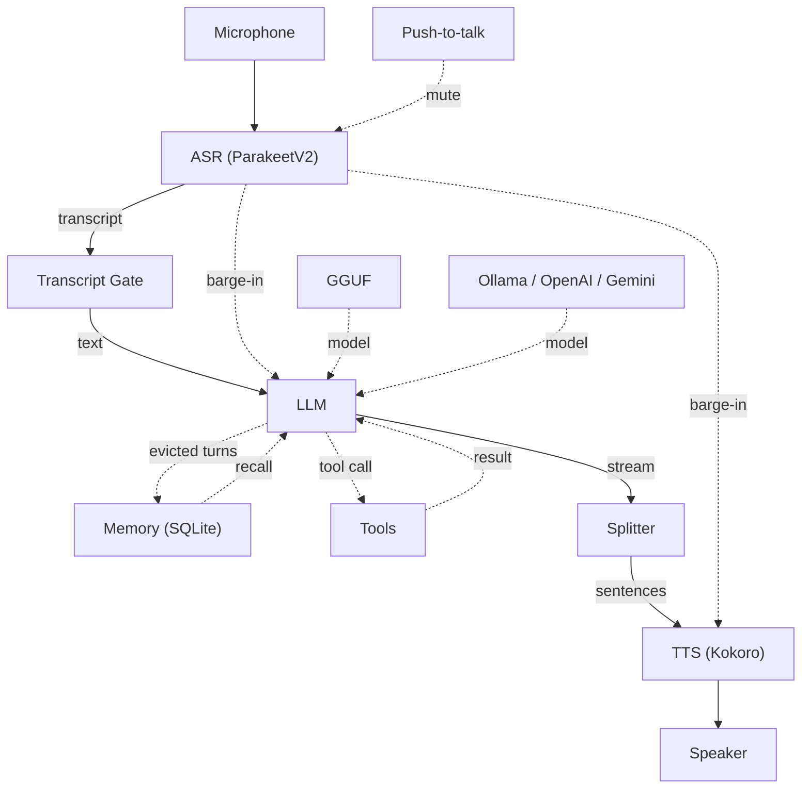

# voxpipe — Modular Voice Pipeline

[](LICENSE)
[]()
[](https://github.com/shervinemp/voxpipe/actions/workflows/ci.yml)

A modular voice-controlled pipeline. Speak, the LLM processes your intent
with tool calling, and the system responds aloud — streaming, interruptible,
and configurable.



## Quick Start

```bash
# 1. Install with the local-model stack
uv sync --extra asr --extra tts --extra gguf

# 2. Configure
cp config.example.yaml config.yaml

# 3. Run
uv run voxpipe
```

`voxpipe --help` lists the options (`--config`, `--push-to-talk`,
`--press-to-reset`, `--log-level`).

## Features

| Layer | What |
|---|---|
| **ASR** | Speech-to-text (ParakeetV2 or CrisperWhisper) with Silero VAD, push-to-talk, device auto-reconnect |
| **LLM** | Local GGUF models, or OpenAI / Gemini / Ollama through LiteLLM |
| **TTS** | Kokoro, spoken sentence by sentence as the reply is generated |
| **Barge-in** | Talking over a reply cancels generation and cuts playback |
| **Tools** | Tool calling with streaming decoders, chaining, async tools, and user-confirmed permissions |
| **Memory** | Conversation history in SQLite + FTS5; relevant past turns are recalled into context |
| **Hotkeys** | Push-to-talk and conversation reset |

## Configuration

Settings are layered: packaged defaults, then `config.yaml` (or `--config` /
`$VOXPIPE_CONFIG`), then environment variables named in `env:` blocks. Unknown
keys are rejected at startup with the offending key named.

```yaml
llm:
  backend: "local"       # "local" (GGUF) or "litellm" (remote APIs)
  model: "Gemma4_12B"
  max_tool_iterations: 1
  max_turns: 20
  local:
    Gemma4_12B:
      decoder: "legacy_xml"
  litellm:
    provider: "ollama"
    model: "qwen3:latest"
    api_base: "http://localhost:11434"

asr:
  sound_device: null     # index or name fragment; null = system default

hotkeys:
  push_to_talk: "<ctrl_r>+<shift_r>"
  press_to_reset: "<ctrl_l>+<ctrl_r>"

conversation_history:
  enabled: true
  db_path: "data/conversations.db"
  max_entries: 1000
  top_k: 2
  ttl_days: 30
```

## Architecture

```
src/
└── voxpipe/
    ├── core/            # Config (YAML + env vars), exceptions, model downloads
    ├── asr/             # Microphone capture, Silero VAD, ParakeetV2 / CrisperWhisper
    ├── tts/             # Kokoro ONNX, speech queue, interruptible audio player
    ├── llm/             # Session, conversation, tools, decoders, providers, context handling
    ├── pipeline/        # ASR → LLM → TTS orchestration, hotkeys, events
    ├── streaming/       # Sentence splitting
    ├── storage/         # Storage protocols, RAM and SQLite backends, MemoryStore
    └── data/            # Default config, model manifest
```

### Pipeline flow

1. **ASR** captures audio on its own thread; the VAD segments speech, and
   push-to-talk mutes the microphone between presses
2. **Transcript gate** drops noise before it reaches the LLM
3. **Memory** attaches relevant past turns to the new message as
   `(Earlier: ...)` context
4. **LLM** answers, calling tools when it needs to
5. **Sentence splitter** hands each sentence to TTS as soon as it is complete
6. **TTS** speaks it; if you start talking, generation is cancelled and
   playback stops (barge-in)

In always-on mode with loudspeakers the microphone can hear the reply and
interrupt it; use headphones or push-to-talk.

### Using the pieces directly

The LLM and storage layers need no audio hardware:

```python
from voxpipe import MemoryHandler, MemoryStore, MaxTurnsStrategy, Session, SQLiteStorage, Tool
from voxpipe.llm import LLMProviders, permission

def get_weather(city: str) -> dict:
    """Look up the current weather.

    Args:
        city: City name.
    """
    return {"city": city, "sky": "clear"}

@permission                      # the user is asked before this runs
def unlock_door(door: str) -> str:
    """Unlock a door."""
    return f"{door} unlocked"

llm = LLMProviders.create("local", "Gemma4_12B")
memory = MemoryStore(SQLiteStorage("data/conversations.db"))
handler = MemoryHandler(MaxTurnsStrategy(20), memory)

with Session(llm, context_handler=handler) as session:
    session.conversation.tools = [
        Tool.from_callable("get_weather", get_weather),
        Tool.from_callable("unlock_door", unlock_door),
    ]
    for chunk in session("What's the weather in Oslo?"):
        print(chunk, end="", flush=True)
```

`session.events(...)` yields text, tool calls and tool results as typed
events; `session.cancel()` stops a turn from another thread.

To embed the whole pipeline, build it from configuration or from your own
components, and subscribe to its events:

```python
from voxpipe.pipeline.pipeline import Pipeline

pipeline = Pipeline.from_config()
pipeline.register_tools(Tool.from_callable("get_weather", get_weather))
pipeline.register_command("stop listening", pipeline.stop)
pipeline.events.on("tts:start", print)
pipeline.run()                   # blocks until stop()
```

### LLM backends

**Local GGUF** — config-driven, no hardcoded model classes.

```yaml
llm:
  local:
    Qwen3:
      n_ctx: 40960
      decoder: "legacy_xml"
    MyModel:
      model_path: "model_files/llm/my_model.gguf"
```

`decoder` selects how tool calls are read from the model's text: `gemma_e2b`,
`legacy_xml` (`<toolcall>` / `<tool_call>` JSON), `general` (all of these), or
`native`.

**LiteLLM** — OpenAI, Gemini, or Ollama.

```yaml
llm:
  backend: "litellm"
  litellm:
    provider: "openai"
    model: "gpt-4o"
    env:
      api_key: OPENAI_API_KEY
```

### ASR providers

**ParakeetV2** (default) — fast ONNX model, `uv sync --extra asr`.

**CrisperWhisper** — verbatim ASR (fillers, stutters, vocal events) with
word-level timings, via [`crisperwhisper`](https://huggingface.co/nyralabs/CrisperWhisper2.0_small).
Install with `uv sync --extra crisperwhisper` (pure-PyTorch backend; the
CTranslate2 backend is Linux-only).

```yaml
asr:
  provider: "CrisperWhisper"
  crisperwhisper:
    model: "nyralabs/CrisperWhisper2.0_small"  # or _large/_medium/_turbo
    mode: "verbatim"          # "verbatim" (default) or "intended"
    language: "en"
```

The weights are released under a non-commercial research license.

## Development

```bash
uv sync --extra dev
uv run pytest                    # unit tests: no models or audio devices needed
uv run pytest -m integration     # needs downloaded weights
uvx ruff check src
uv run --with mypy mypy
```

## License

MIT
